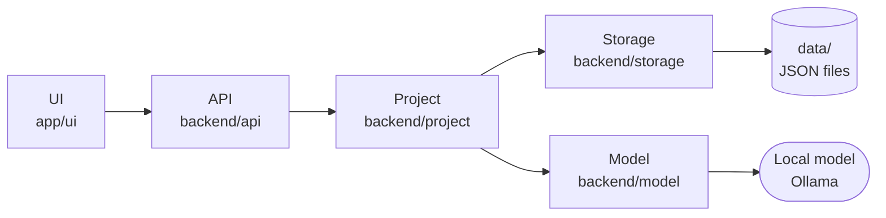

# 03 — Architecture

How the system is put together, and the rules that keep its parts apart.

## 1. The layers

Arrows show who calls whom; every answer returns the same way.

| Layer | Folder | What it does |
|---|---|---|
| **UI** | `app/ui/` | TypeScript in the browser: shows the map and chat, sends requests |
| **API** | `backend/api/` | The only way in: a FastAPI app (`app.py`) routes each request, shapes each answer, serves the page files; in the public demo, `api/demo/` checks every request first ([[demo]]) |
| **Project** | `backend/project/` | What a project is and what can be done to it |
| **Storage** | `backend/storage/` | The only code that reads or writes `data/` (plain JSON), or a visitor's sandbox copy of it in the public demo |
| **Model** | `backend/model/` | Talks to the language model (local Ollama; OpenRouter in the public demo), and packs what it is given |

`app/server.py` only starts the server (localhost unless `HOST` is set). `backend/seed/` builds the demo's data through the Project layer, run by hand ([[05-decisions]] #83). `backend/foundation/`
(math, time) is not used by anything today.

## 2. Inside Project

| Folder | What it holds |
|---|---|
| `node/` | What a node is: identity, children, rules ([[05-decisions]] #52) |
| `changes/` | Each map edit as a full record, and replaying a log into its tree ([[05-decisions]] #80, #83) |
| `saved_trees/` | Saving a branch as structure and inserting it again ([[05-decisions]] #54) |
| `panes/create/` | Creating, naming, archiving projects; which account owns one |
| `panes/canvas/` | Changing the map: add, remove, paste, folder |
| `panes/chat/` | A chat turn, slash commands, and the thread as shown |
| `status/` | The Current state summary (shown to the user and the model) |
| `timeline.py` | A project's history, read from its saved events |

`node/` sits above the panes: canvas and chat are two ways of showing and
changing the same nodes; neither owns them.

## 3. Rules at the boundaries

- **The UI decides nothing.** It shows data and sends requests; every
  decision about a project or its nodes is made in the backend.
- **One way in, one way to the data.** Everything enters through the API,
  and only Storage touches `data/`. If data later comes from somewhere
  else, those are the two places that change.
- **Code owns state and identity; the model only assists.** Ids, the
  structure, saving, and every command are plain code. The model reads
  and answers; it never writes to the project.
- **A role is not a model.** What a model call is for and which model
  answers are separate: the model is chosen in one place
  (`backend/model/client.py`) and can be swapped there.

## 4. Where the model is used

One place, behind `backend/model/client.py`:

| Use | Code |
|---|---|
| A chat reply | `panes/chat/reply.py` |

Everything else — adding and removing nodes, paste, folders, saved
trees, ids, `/add`, `/select`, `/id`, logs — is deterministic.

## 5. Principles

- **Local-first:** the real copy of the data lives on the user's
  machine.
- **Open formats:** data stays in plain, readable files where practical.
- **Replaceable infrastructure:** services and external APIs are
  dependencies, not the source of truth.
- **Privacy by design:** personal data stays local where possible.
- **Start simple:** no database, vector store, or new framework until a
  real need shows up.

## See also

- [[04-current-state]] — what is true in the code right now
- [[05-decisions]] — why it was built this way
